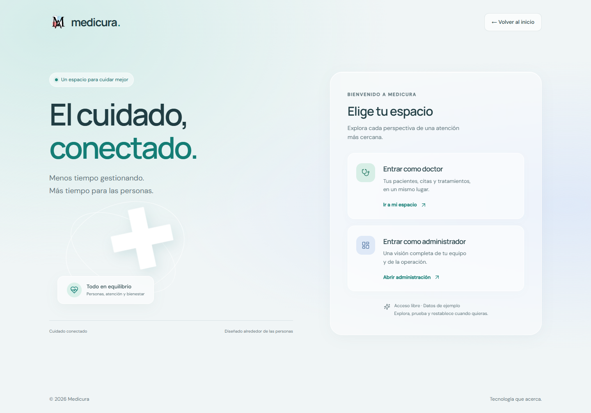
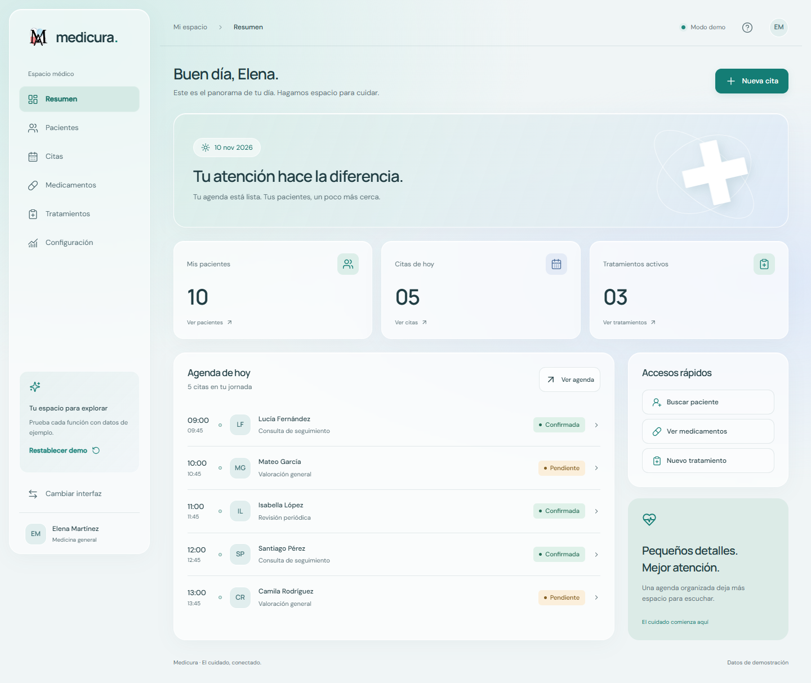
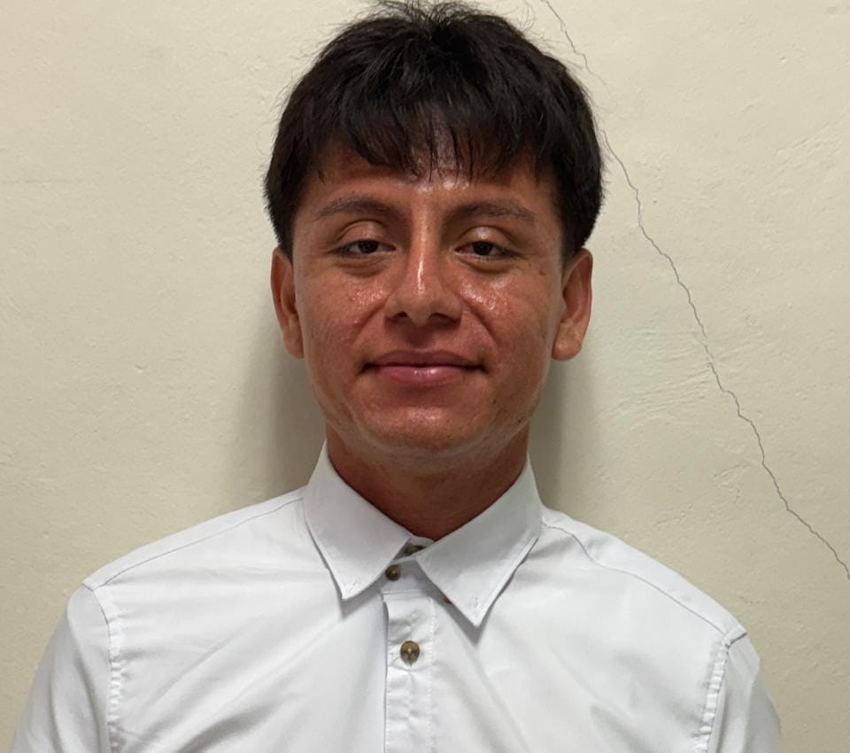
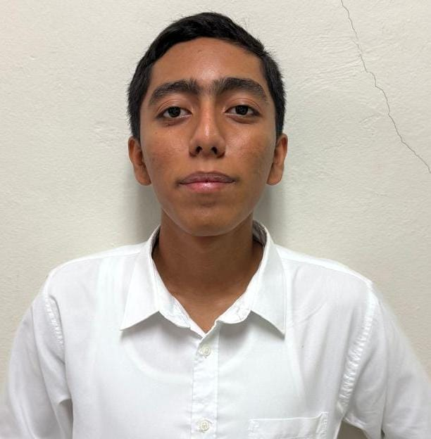
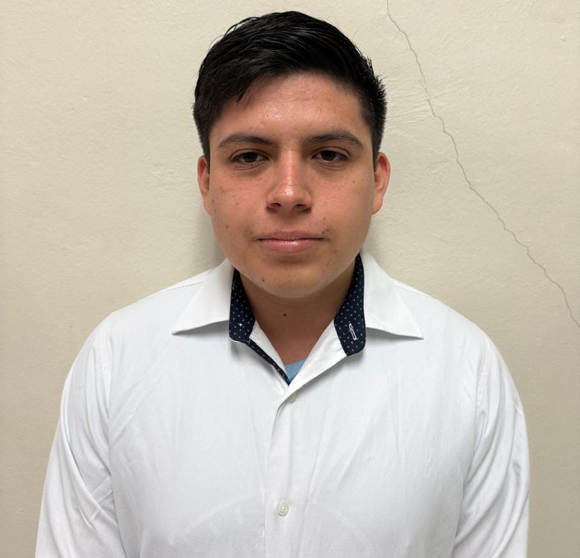
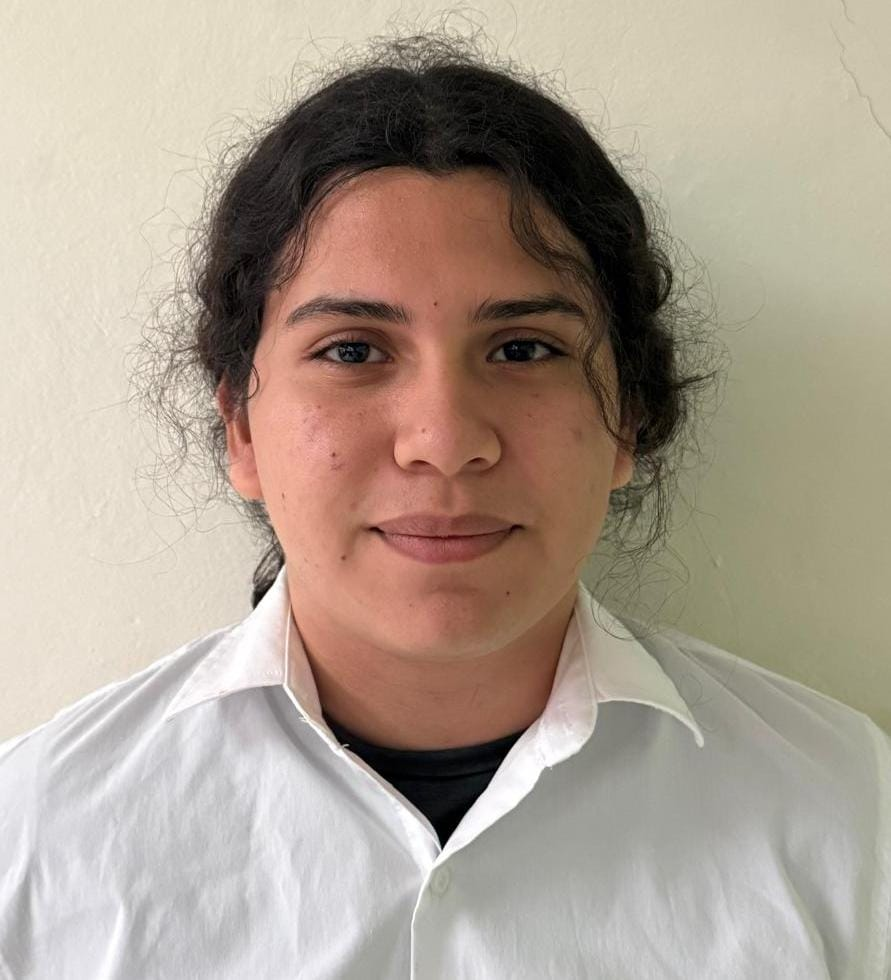

<div align="center">


# Medicura

### El cuidado, conectado.

Una experiencia de gestión médica centrada en las personas.  
Pacientes, equipo y atención en un mismo espacio.

**Portafolio · Demo interactiva · Glassmorphism · GSAP**

[La propuesta](#la-propuesta) · [Público](#para-quién-está-pensado) · [Experiencia](#dos-perspectivas-un-mismo-cuidado) · [Equipo](#equipo-de-desarrollo) · [Instalación](#explora-el-proyecto)

</div>

---



## La propuesta

**Medicura explora cómo simplificar la organización de la atención médica mediante una interfaz clara, cercana y conectada.** Su orientación combina gestión de información, coordinación de equipos y diseño de experiencia de usuario en el ámbito de la salud.

El proyecto nació como una plataforma de gestión médica y evolucionó hacia una **demostración interactiva de portafolio**. Esta versión permite recorrer los flujos del producto, probar sus interacciones y conocer el trabajo de diseño y desarrollo detrás de cada pantalla.

El objetivo de producto es reducir la fricción administrativa para que los profesionales puedan dedicar más atención a las personas. La demo muestra esa propuesta mediante escenarios ficticios; no constituye un sistema clínico en producción.

## Para quién está pensado

| Público | Necesidad | Experiencia propuesta |
| :--- | :--- | :--- |
| **Médicos y profesionales de la salud** | Consultar pacientes y organizar su jornada | Un espacio con agenda, pacientes asociados y seguimiento de tratamientos |
| **Administradores de clínicas y centros médicos** | Coordinar personal, instituciones y actividad | Una visión general con gestión de registros, solicitudes e indicadores |
| **Pacientes, como beneficiarios de la propuesta** | Recibir atención con mejor continuidad y organización | Información relacionada entre consultas, profesionales y tratamientos; esta versión no incluye un portal de pacientes |
| **Reclutadores y colaboradores** | Evaluar decisiones de producto y capacidades técnicas | Flujos navegables, componentes reutilizables, diseño responsive y código verificable |

## Qué problema aborda

Cuando la agenda, los expedientes y la información del equipo se consultan por separado, organizar la atención exige más pasos y resulta difícil mantener una visión del conjunto. Medicura propone reunir esas tareas en una experiencia común.

| Dificultad | Cómo la aborda Medicura |
| :--- | :--- |
| **Información dispersa** | Relaciona pacientes, médicos, citas y tratamientos en una misma interfaz |
| **Conflictos de agenda** | Valida horarios y detecta solapamientos de médico o paciente en la demo |
| **Seguimiento fragmentado** | Permite consultar el historial de citas y tratamientos de cada paciente |
| **Poca visibilidad operativa** | Presenta indicadores, solicitudes pendientes y reportes desde el panel administrativo |
| **Procesos difíciles de explorar** | Ofrece acciones claras, filtros, confirmaciones y mensajes de validación |

Estas soluciones representan el comportamiento diseñado del prototipo. No se atribuyen resultados clínicos ni ahorros medidos a la demostración.

## Dos perspectivas, un mismo cuidado

<table>
<tr>
<th align="left">Espacio médico</th>
<th align="left">Administración</th>
</tr>
<tr>
<td valign="top">

- Resumen y agenda del día.
- Búsqueda y asociación de pacientes.
- Creación, edición y consulta de citas.
- Gestión de tratamientos y medicamentos.
- Configuración con datos sensibles de solo lectura.
- Actualización local de foto y simulación de contraseña.

</td>
<td valign="top">

- Indicadores de la comunidad médica.
- Consulta de doctores y revisión de solicitudes.
- Gestión de pacientes e instituciones.
- Organización de citas y medicamentos.
- Reportes e impresión con opción de guardar PDF.
- Reinicio del conjunto de datos de la demo.

</td>
</tr>
</table>



### Un recorrido para conocerlo

1. Entra desde la pantalla de acceso y elige **doctor** o **administrador**.
2. Consulta la agenda y abre un paciente para explorar su información.
3. Crea o edita una cita; prueba la validación de horarios.
4. Cambia de interfaz y revisa las solicitudes o los reportes.
5. Usa **Restablecer demo** para volver al punto de partida.

## Diseño que acompaña

La identidad visual utiliza superficies de **vidrio esmerilado**, fondos menta y azul y una jerarquía que da prioridad a las personas, la agenda y las acciones.

- **Movimiento con propósito:** GSAP coordina entradas y transiciones de menú y diálogos.
- **Lectura clara:** Manrope en títulos, DM Sans en texto e iconos SVG de Lucide.
- **Adaptación responsive:** layouts para escritorio, tablet y móvil.
- **Interacción accesible:** foco visible, etiquetas, navegación por teclado y respeto a la preferencia de movimiento reducido.
- **Identidad propia:** logo original de Medicura y reconocimiento del equipo de desarrollo.

Consulta las decisiones visuales en [el sistema de diseño](docs/design-system.md).

## Equipo de desarrollo

Los roles corresponden a la participación del equipo en el proyecto original.

<table>
<tr>
<td align="center" width="33%"><br><strong>Pedro Dzul</strong><br>Líder · Diseño móvil</td>
<td align="center" width="33%"><br><strong>Angel Uitzil</strong><br>Diseño y desarrollo web</td>
<td align="center" width="33%"><br><strong>Steven Ku</strong><br>Diseño y desarrollo web</td>
</tr>
<tr>
<td align="center"><br><strong>Madox Que</strong><br>Líder · Diseño y desarrollo web</td>
<td align="center"><br><strong>Ali Cob</strong><br>Desarrollo y administración de BD</td>
<td align="center"><br><strong>Salvador Poot</strong><br>Diseño web</td>
</tr>
</table>

## Cómo funciona esta versión

| Capa | Tecnología y responsabilidad |
| :--- | :--- |
| Páginas y rutas | **Laravel 12 + Blade** sirven la interfaz y los arreglos iniciales |
| Interactividad | **JavaScript** gestiona formularios, navegación, relaciones y validaciones |
| Estado local | **sessionStorage** conserva los cambios durante la navegación en la misma pestaña |
| Diseño y movimiento | **CSS + GSAP** definen superficies, adaptación y animaciones |
| Compilación | **Vite** empaqueta estilos, scripts, fuentes e iconos locales |
| Verificación | **PHPUnit, Node Test Runner y Playwright** cubren lógica y recorridos |

```text
Arreglos PHP → Controlador → Vista Blade → Interacciones en el navegador
                                              ↕
                                         sessionStorage
```

**Alcance de la demo:** acceso libre, datos ficticios, sin base de datos ni envío de correos. El filtrado por médico organiza la experiencia; no representa autorización. El cambio de contraseña es una simulación y no almacena contraseñas. Los reportes utilizan el diálogo de impresión del navegador.

Los cambios locales pueden restablecerse y no se sincronizan entre dispositivos. Si el almacenamiento del navegador no está disponible, la interfaz lo informa. Se conserva PHP para servir las páginas: no es una exportación de HTML para hosting exclusivamente estático.

<details>
<summary><strong>Explorar la estructura técnica</strong></summary>

```text
app/
  Data/DemoData.php                 Arreglos iniciales de la demo
  Http/Controllers/DemoController.php
resources/
  views/                           Inicio, acceso y contenedor de los paneles
  js/app.js                        Pantallas e interacciones
  js/demo-store.js                  Reglas, validaciones y relaciones
  css/app.css                      Sistema visual responsive
public/
  logo.png                         Identidad original
  images/team/                     Fotografías del equipo
tests/
  Feature/                         Pruebas de Laravel
  js/                              Pruebas de lógica local
  browser/                         Recorridos con Playwright
```

La demo comienza con 6 doctores, 18 pacientes, 3 instituciones, 3 medicamentos ficticios, 18 citas y 4 tratamientos ficticios. Los datos relacionados comparten identificadores para mantener consistencia entre listados, detalles e indicadores.

</details>

## Explora el proyecto

**Requisitos:** PHP 8.2+, Composer 2 y Node.js 20.19+ o 22.12+. No necesitas MySQL, migraciones, SMTP ni credenciales.

```bash
composer install
```

Copia `.env.example` a `.env`. En PowerShell:

```powershell
Copy-Item .env.example .env
```

Prepara los assets e inicia la aplicación:

```bash
php artisan key:generate
npm ci
npm run build
php artisan serve
```

Abre [la página principal](http://localhost:8000) o [el selector de interfaz](http://localhost:8000/login). Durante el desarrollo, `composer dev` inicia Laravel y Vite con recarga automática.

<details>
<summary><strong>Rutas y comandos de verificación</strong></summary>

| Ruta | Contenido |
| :--- | :--- |
| `/` | Presentación, equipo de desarrollo y contacto simulado |
| `/login` | Selección de interfaz |
| `/doctor` | Panel médico |
| `/doctor/settings` | Configuración del médico |
| `/admin` | Panel administrativo |
| `/api/health` | Estado de la aplicación |

```bash
npm run build
npm test
php artisan test
npx playwright install chromium
npm run test:e2e
```

Para usar Chrome ya instalado, en PowerShell:

```powershell
$env:PLAYWRIGHT_CHANNEL='chrome'
npm run test:e2e
```

Las pruebas incluyen acceso público, rutas profundas, relaciones, validación de horarios, operaciones sobre registros, filtros, persistencia local, impresión, móvil y movimiento reducido. Playwright reutiliza el servidor del puerto 8000 o inicia uno para las pruebas.

</details>

---

<div align="center">

**Medicura · Tecnología que acerca.**  
Un proyecto de portafolio sobre diseño, interacción y organización del cuidado.

</div>
